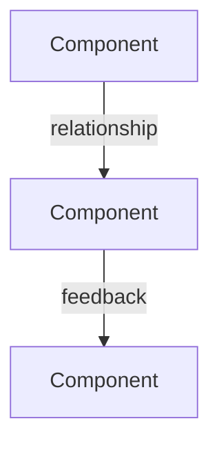

# Analysis Output Template

## Analysis: [Focus Area]

### Deepened Ask
**Expert move**: [what a top practitioner would do here that wasn't asked for]
**Rawest material**: [primary source — reachable now / not reachable]
**Instruments**: [the field's methods and tools]
**Verifier**: [what, other than the model or the user, shows the result is right]
**Ask, deepened**: [1-3 sentences; on quick, "unchanged" if it didn't change]

### Triage
**Type**: {technical|product|strategic|comparative} / **Scale**: {quick|standard|deep}
**Lenses**: {Depth, Range, Altitude — or Speed (default)}
**Agents**: {list activated agents}
**Models**: {list selected mental models}

### Evidence Summary
_Only include when Phase 0 ran. Summarize key findings from explore/document-specialist/scientist agents. Tag each item `raw` or `digested`._

[Codebase signals | External benchmarks | Quantitative data — as applicable]

### First-Principles View
[3-5 sentences. Core truth, stripped to essentials.]

### System Map
[When relationships are simple, use prose. When 3+ components interact, use Mermaid:]

### 7-Step Path
| Step | Now | 30 Days | 90 Days | 1 Year |
|-|-|-|-|-|
| Experience | | | | |
| Value | | | | |
| Retention | | | | |
| Habit | | | | |
| Advocacy | | | | |
| Lock-in | | | | |
| Ecosystem | | | | |

### Competitive Response
[What competitors would do + our moat]

### AAARRR Breakdown
- Acquisition:
- Activation:
- Retention:
- Referral:
- Revenue:

### Project-Level Impact
| Action | Project Impact | Business Impact | Dependencies | Priority Alignment |
|-|-|-|-|-|
| | | | | |

### Premortem Cycle
_Only include when Phase P ran (standard/deep, or quick + keyword override)._

**Bet**: [one sentence — what must be true if we execute the actions]
**Horizon**: 30d | 90d | 1y
**Headline if failed**: [postmortem headline at the horizon]

| # | Failure mode | Mechanism | L | I | Early signal | Owner | Mitigation / cut |
|-|-|-|-|-|-|-|-|
| 1 | | | H/M/L | H/M/L | | eng/product/ops/market | Action #n / new / drop |

**Kill criteria**
1. [falsifiable stop condition]
2. …

**Action deltas from premortem**
- [confidence changes, added/deferred/killed actions]

_If Phase P was skipped (quick without keyword): optional thin inversion table only:_

| Risk | Likelihood | Impact | Prevention |
|-|-|-|-|
| | | | |

### Prioritized Actions
| # | Action | Impact | Effort | Confidence | Reversible | Horizon | AAARRR | Verifier | Why |
|-|-|-|-|-|-|-|-|-|-|
| 1 | | H/M/L | H/M/L | H/M/L | Y/N | Quick/Foundation/Long | | | |

_Confidence column populated when Phase P and/or Phase 9 adjusted ratings. Otherwise omit._
_Verifier: what, other than the model or the user, shows the action worked (a test, metric, counterparty signal). `same as #n` is fine; `none — unverifiable` forces Confidence to L._
_Optional: note "mitigates premortem #k" or "exposed to #k" in Why._

### Stress Test Notes
_Only include when Phase 9 ran and surfaced material changes._

[Blind spots identified | Assumptions challenged | Premortem kill-criteria attacks | Adjustments made]

### World-Class Criteria
[3-5 specific, measurable signals that prove we're there]

---

## Comparison Mode Template

_Use this variant when triage classifies as `comparative`._

## Comparison: [Option A] vs [Option B]

### Deepened Ask
_Same five lines as the standard template, written for the decision, not per option._

### Triage
**Type**: comparative + {technical|product|strategic} / **Scale**: {quick|standard|deep}
**Lenses**: {Depth, Range, Altitude — or Speed (default)}

### Evidence Summary
_Per-option evidence if Phase 0 ran._

### Side-by-Side Analysis
| Dimension | Option A | Option B |
|-|-|-|
| First-Principles Fit | | |
| Complexity | | |
| Scalability | | |
| Reversibility | | |
| Time to Value | | |
| Risk Profile | | |
| Team Fit | | |

### System Maps
_One diagram per option if warranted, or a combined diagram showing interaction._

### Premortem Cycle (shared)
_Only when Phase P ran. Prefer one table with A/B severity rather than two full cycles._

**Bet**: …
**Horizon**: …

| # | Failure mode | Mechanism | Worse for | L | I | Early signal | Mitigation / cut |
|-|-|-|-|-|-|-|-|
| 1 | | | A / B / both | H/M/L | H/M/L | | |

**Kill criteria** (for the recommended path after pick)
1. …
2. …

### Recommendation
**Winner**: [Option] for [context/constraints].
**Tradeoff**: [What you give up by choosing the winner.]
**When to reconsider**: [Conditions that would flip the recommendation — include kill criteria.]

### Prioritized Actions (for recommended option)
| # | Action | Impact | Effort | Confidence | Reversible | Horizon | Verifier | Why |
|-|-|-|-|-|-|-|-|-|
| 1 | | H/M/L | H/M/L | H/M/L | Y/N | Quick/Foundation/Long | | |
