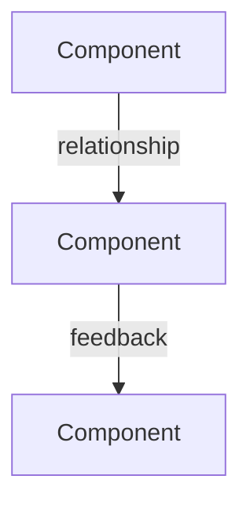

# Analysis Output Template

Show results, not process. Print the Route line, then only the sections whose module ran, in this order.
Never print a section to say it was skipped; the Route line already says so.

## Analysis: [Focus Area]

**Route**: {type}/{scale} · modules: {list} · skipped: {module (reason), …} · models: {3-4, or none}
**Ask, deepened**: {one line, only if router Step 0 changed the ask}

### Answer
_Inline route only (no modules ran): the answer in 1-3 short paragraphs, then:_
**Verifier**: [what, other than the model or the user, would show this is right]

### Evidence Summary
_Phase 0. Each item tagged `raw` or `digested`; start with the rawest material._

### First-Principles View
_Step 1. 3-5 sentences: the core truth, stripped to essentials._

### Analysis
_Step 2 models with their instruments; a borrowed technique (Range) and what it changed; Steps 3, 5, 7, 8 as
the route lists them. Prose or a compact table — no empty framework headings._

### System Map
_Step 4, when 3+ components interact:_

### Premortem Cycle
_Phase P._

**Bet**: [one sentence — what must be true if we execute the actions]
**Horizon**: 30d | 90d | 1y
**Headline if failed**: [postmortem headline at the horizon]

| # | Failure mode | Mechanism | L | I | Early signal | Owner | Mitigation / cut |
|-|-|-|-|-|-|-|-|
| 1 | | | H/M/L | H/M/L | | eng/product/ops/market | Action #n / new / drop |

**Kill criteria**
1. [falsifiable stop condition]
2. …

**Action deltas from premortem**
- [confidence changes, added/deferred/killed actions]

_When Phase P is skipped but Step 6 ran: a thin table instead — | Risk | Likelihood | Impact | Prevention |_

### Prioritized Actions
_Actions module._

| # | Action | Impact | Effort | Confidence | Reversible | Horizon | AAARRR | Verifier | Why |
|-|-|-|-|-|-|-|-|-|-|
| 1 | | H/M/L | H/M/L | H/M/L | Y/N | Quick/Foundation/Long | | | |

_Confidence only when Phase P or Phase 9 adjusted ratings; AAARRR only for product/strategic routes._
_Verifier: what, other than the model or the user, shows the action worked (a test, metric, counterparty signal). `same as #n` is fine; `none — unverifiable` forces Confidence to L._

### Project-Level Impact
_Only with project context files:_ | Action | Project Impact | Business Impact | Dependencies | Priority Alignment |

### Stress Test Notes
_Phase 9, only when it changed something material: blind spots, challenged assumptions, kill-criteria attacks, adjustments._

### World-Class Criteria
_3-5 specific, measurable signals that prove we're there, each checkable by someone other than the author._

---

## Comparison Mode Template

_Use when the router found a real choice (atom a4)._

## Comparison: [Option A] vs [Option B]

**Route**: comparative + {type}/{scale} · modules: {list} · skipped: {…} · models: {…}

### Evidence Summary
_Per option, when Phase 0 ran; tagged `raw` or `digested`._

### Side-by-Side Analysis
| Dimension | Option A | Option B |
|-|-|-|
| First-Principles Fit | | |
| Complexity | | |
| Scalability | | |
| Reversibility | | |
| Time to Value | | |
| Risk Profile | | |
| Team Fit | | |

### Premortem Cycle (shared)
_Phase P. One table with A/B severity rather than two full cycles._

**Bet**: …
**Horizon**: …

| # | Failure mode | Mechanism | Worse for | L | I | Early signal | Mitigation / cut |
|-|-|-|-|-|-|-|-|
| 1 | | | A / B / both | H/M/L | H/M/L | | |

**Kill criteria** (for the recommended path after pick)
1. …
2. …

### Recommendation
**Winner**: [Option] for [context/constraints].
**Tradeoff**: [What you give up by choosing the winner.]
**When to reconsider**: [Conditions that would flip the recommendation — include kill criteria.]

### Prioritized Actions (for recommended option)
| # | Action | Impact | Effort | Confidence | Reversible | Horizon | Verifier | Why |
|-|-|-|-|-|-|-|-|-|
| 1 | | H/M/L | H/M/L | H/M/L | Y/N | Quick/Foundation/Long | | |
